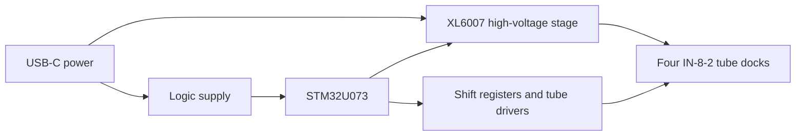

# Nixie clock hardware

Two manufactured hardware revisions explore a USB-powered nixie display. **Rev1 is just a boost-converter board built to test the topology. Rev2 contains the full schematic**, integrating the high-voltage supply, MCU, and four tube docks.

## Goals and architecture

Rev1 isolates the high-voltage stage so its topology and control can be evaluated independently. An XL6007 and TDK ATB322524 transformer form the boost stage, with an MCP6001 in the control circuitry. The simulation sources document startup behavior and the limits of the behavioral models.

Rev2 adds an STM32U073 controller, four IN-8-2 docks, 74HC595 shift registers, ULN2003A arrays, and discrete high-voltage drivers. USB-C supplies the board; the MCU controls the display and the adjustable high-voltage supply.

## Revisions

| Revision | Scope | Design | Simulation |
| --- | --- | --- | --- |
| Rev1 | Boost topology test board | [KiCad project](hardware/rev1/nixie_rev1.kicad_pro), [notes](hardware/rev1/README.md) | [Models, runner, and results](sim/rev1/) |
| Rev2 | Full clock schematic and board | [KiCad project](hardware/rev2/nixie_rev2.kicad_pro), [notes](hardware/rev2/README.md) | [Models, runner, and results](sim/rev2/) |

Revision notes retain the modeled operating points and component-stress limitations. The simulations characterize topology and control; they do not constitute measured efficiency or stress qualification.

## Working with the design

Run `git lfs pull` after cloning. Each revision includes local KiCad libraries; required component models, datasheets, manufacturing rules, and review evidence live in [assets](assets/). Native design use does not require infra access. See [development and release tooling](docs/development.md) for the private maintainer toolchain.
