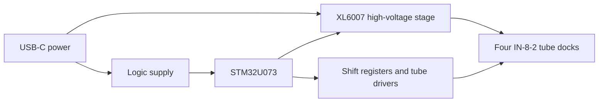
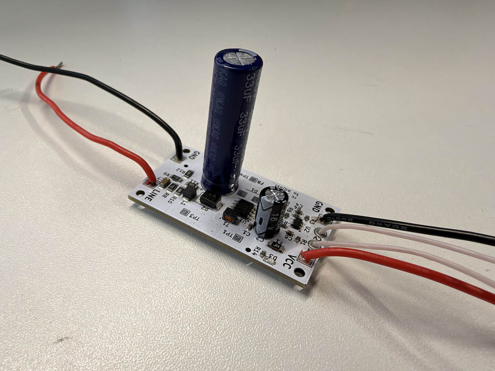
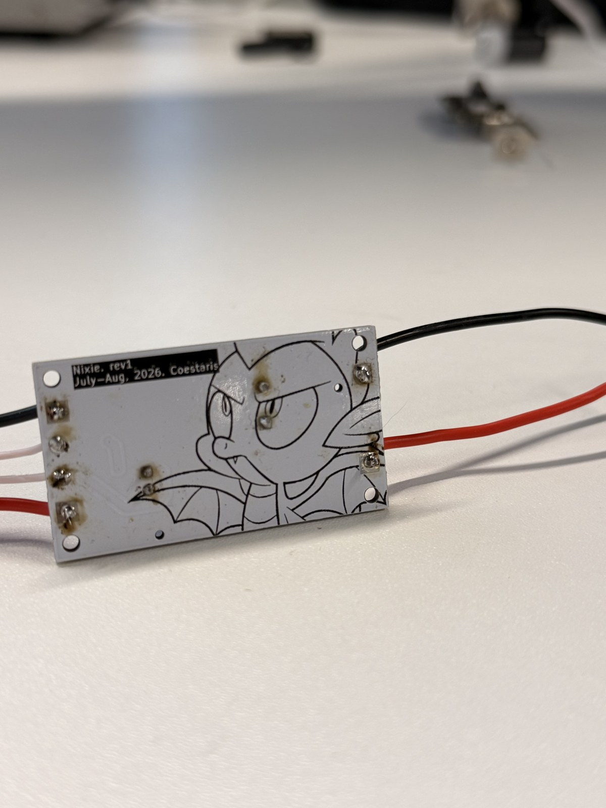

# Nixie clock

Both clock revisions and the tube docks have been manufactured and tested.

> **AI use.** The authors use AI for additional validation, component research, testbench setup and simulation, intermediate design reviews, release setup, and assistance with KiCad and 3D model edits. The authors developed the original designs and schematics manually, and other people reviewed them. The authors make the technical and visual decisions and take responsibility for them.

This USB-powered clock drives four IN-8-2 nixie tubes. Rev1 tests the boost converter. Rev2 combines the high-voltage supply, controller, and tube drivers on one motherboard. Each standalone dock carries one tube and plugs into Rev2.

## Goals and architecture

Rev1 isolates the high-voltage stage so its topology and control can be evaluated independently. An XL6007 and TDK ATB322524 transformer form the boost stage, with an MCP6001 in the control circuitry. The simulation sources document startup behavior and the limits of the behavioral models.

Rev2 adds an STM32U073 controller, four IN-8-2 docks, 74HC595 shift registers, ULN2003A arrays, and discrete high-voltage drivers. USB-C supplies the board. The MCU controls the display and the adjustable high-voltage supply.

## Hardware projects

| Board | Purpose | Design | Simulation |
| --- | --- | --- | --- |
| dock_rev1 | Tube carrier | [KiCad project](hardware/dock_rev1/dock_rev1.kicad_pro) | — |
| rev1 | Boost converter test board | [KiCad project](hardware/rev1/nixie_rev1.kicad_pro) | [Models, runner, and test cases](sim/rev1/) |
| rev2 | Four-tube clock motherboard | [KiCad project](hardware/rev2/nixie_rev2.kicad_pro) | [Models, runner, and test cases](sim/rev2/) |

### dock_rev1 - IN-8-2 dock

The two-layer dock carries one wire-ended IN-8-2 tube. Four 1×3, 2.54 mm sockets mate with the motherboard pin headers and carry the anode, digit cathodes, and decimal point. The assembly model includes the tube and all four sockets. [Dock release](https://github.com/Coestaris/hw-nixie/releases/tag/dock_rev1)

Top and bottom views

| File | Download |
| --- | --- |
| Schematic PDF | [dock_rev1-schematic.pdf](https://github.com/Coestaris/hw-nixie/releases/download/dock_rev1/dock_rev1-schematic.pdf) |
| PCB PDF | [dock_rev1-pcb.pdf](https://github.com/Coestaris/hw-nixie/releases/download/dock_rev1/dock_rev1-pcb.pdf) |
| Gerbers and drill files | [dock_rev1-gerbers.zip](https://github.com/Coestaris/hw-nixie/releases/download/dock_rev1/dock_rev1-gerbers.zip) |
| 3D assembly model | [dock_rev1.stpz](https://github.com/Coestaris/hw-nixie/releases/download/dock_rev1/dock_rev1.stpz) |

### rev1 - boost topology test board

Rev1 isolates the high-voltage converter and its control loop for bring-up. [Rev1 release](https://github.com/Coestaris/hw-nixie/releases/tag/rev1)

Top and bottom views

| File | Download |
| --- | --- |
| Schematic PDF | [nixie_rev1-schematic.pdf](https://github.com/Coestaris/hw-nixie/releases/download/rev1/nixie_rev1-schematic.pdf) |
| PCB PDF | [nixie_rev1-pcb.pdf](https://github.com/Coestaris/hw-nixie/releases/download/rev1/nixie_rev1-pcb.pdf) |
| Gerbers and drill files | [nixie_rev1-gerbers.zip](https://github.com/Coestaris/hw-nixie/releases/download/rev1/nixie_rev1-gerbers.zip) |
| JLCPCB BOM | [nixie_rev1-jlcpcb-bom.csv](https://github.com/Coestaris/hw-nixie/releases/download/rev1/nixie_rev1-jlcpcb-bom.csv) |
| JLCPCB placement | [nixie_rev1-jlcpcb-pnp.csv](https://github.com/Coestaris/hw-nixie/releases/download/rev1/nixie_rev1-jlcpcb-pnp.csv) |
| 3D assembly model | [nixie_rev1.stpz](https://github.com/Coestaris/hw-nixie/releases/download/rev1/nixie_rev1.stpz) |
| Simulation netlist, log, and results | [nixie_rev1-simulation.tar.gz](https://github.com/Coestaris/hw-nixie/releases/download/rev1/nixie_rev1-simulation.tar.gz) |

#### Hardware bring-up

The converter started normally, and the enable pin worked as expected. The bulk capacitor footprint limited the choice of high-voltage electrolytics. The only suitable part available for bring-up was a physically large 33 µF electrolytic, which replaced the 2.2 µF part specified in the schematic. The larger capacitance slowed the response to voltage adjustments.

#### Bench test results

- **Output voltage and ripple.** With a load equivalent to 20 kΩ (10 mA at 200 V), the output reached about 240–245 V with approximately 40–50 mV of ripple.
- **Voltage adjustment.** As the control setting increased, the output rose roughly linearly at first, then leveled off in a way that resembled an exponential approach to a limit. Under these test conditions, about 230 V was the practical upper limit for normal regulation.
- **Switching spikes.** At 245 V output, the measured spikes stayed at or below 40 V. This was considered acceptable for the transformer, so the prototype ran without a snubber.

Bring-up photos

### rev2 - clock motherboard

Rev2 supplies power and digit-drive signals to four plug-in docks. The assembly model includes the docks, their pin headers, and M2 standoffs. [Rev2 release](https://github.com/Coestaris/hw-nixie/releases/tag/rev2)

Top and bottom views

| File | Download |
| --- | --- |
| Schematic PDF | [nixie_rev2-schematic.pdf](https://github.com/Coestaris/hw-nixie/releases/download/rev2/nixie_rev2-schematic.pdf) |
| PCB PDF | [nixie_rev2-pcb.pdf](https://github.com/Coestaris/hw-nixie/releases/download/rev2/nixie_rev2-pcb.pdf) |
| Gerbers and drill files | [nixie_rev2-gerbers.zip](https://github.com/Coestaris/hw-nixie/releases/download/rev2/nixie_rev2-gerbers.zip) |
| JLCPCB BOM | [nixie_rev2-jlcpcb-bom.csv](https://github.com/Coestaris/hw-nixie/releases/download/rev2/nixie_rev2-jlcpcb-bom.csv) |
| JLCPCB placement | [nixie_rev2-jlcpcb-pnp.csv](https://github.com/Coestaris/hw-nixie/releases/download/rev2/nixie_rev2-jlcpcb-pnp.csv) |
| 3D assembly model | [nixie_rev2.stpz](https://github.com/Coestaris/hw-nixie/releases/download/rev2/nixie_rev2.stpz) |
| Simulation netlist, log, and results | [nixie_rev2-simulation.tar.gz](https://github.com/Coestaris/hw-nixie/releases/download/rev2/nixie_rev2-simulation.tar.gz) |
