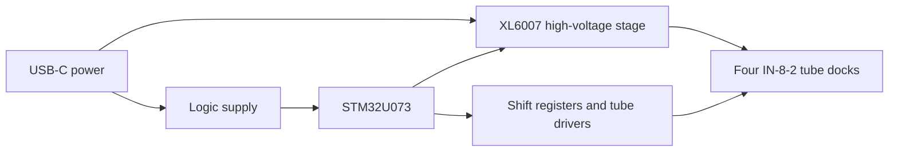

# Nixie clock hardware

Rev1 and Rev2 are manufactured hardware revisions for a USB-powered nixie display. **Rev1 tests the boost converter. Rev2 integrates the high-voltage supply, MCU, and four tube docks.** The standalone `dock_rev1` project carries one IN-8-2 tube and mates with the Rev2 motherboard.

## Goals and architecture

Rev1 isolates the high-voltage stage so its topology and control can be evaluated independently. An XL6007 and TDK ATB322524 transformer form the boost stage, with an MCP6001 in the control circuitry. The simulation sources document startup behavior and the limits of the behavioral models.

Rev2 adds an STM32U073 controller, four IN-8-2 docks, 74HC595 shift registers, ULN2003A arrays, and discrete high-voltage drivers. USB-C supplies the board; the MCU controls the display and the adjustable high-voltage supply.

## Hardware projects

| Release target | Scope | Design | Simulation |
| --- | --- | --- | --- |
| `rev1` | Boost topology test board | [KiCad project](hardware/rev1/nixie_rev1.kicad_pro), [notes](hardware/rev1/README.md) | [Models, runner, and results](sim/rev1/) |
| `rev2` | Full clock schematic and board | [KiCad project](hardware/rev2/nixie_rev2.kicad_pro), [notes](hardware/rev2/README.md) | [Models, runner, and results](sim/rev2/) |
| `dock` | `dock_rev1`, standalone IN-8-2 tube dock | [KiCad project](hardware/dock_rev1/dock_rev1.kicad_pro), [assembly notes and pinout](hardware/dock_rev1/README.md) | — |

Revision notes retain the modeled operating points and component-stress limitations. The simulations characterize topology and control; they do not constitute measured efficiency or stress qualification.

## Working with the design

Run `git lfs pull` after cloning. Each project includes local KiCad libraries. Component models, datasheets, manufacturing rules, and review evidence live in [assets](assets/). The pinned private `infra` submodule supplies the maintainer toolchain.

The **Hardware release** workflow accepts a string `target`. `rev1` and `rev2` select the corresponding motherboard project and existing release tag. `dock` resolves to `hardware/dock_rev1/` and uses `dock_rev1` as its release tag. The dock uses a fabrication-only profile for hand assembly.

## Board renders and releases

### Rev1 — boost topology test board

[Published rev1 release](https://github.com/Coestaris/hw-nixie/releases/tag/rev1). The release workflow passed the complete gate and manufacturing export.

Top and bottom views

| File | Download |
| --- | --- |
| Schematic PDF | [nixie_rev1-schematic.pdf](https://github.com/Coestaris/hw-nixie/releases/download/rev1/nixie_rev1-schematic.pdf) |
| PCB PDF | [nixie_rev1-pcb.pdf](https://github.com/Coestaris/hw-nixie/releases/download/rev1/nixie_rev1-pcb.pdf) |
| Gerbers and drill files | [nixie_rev1-gerbers.zip](https://github.com/Coestaris/hw-nixie/releases/download/rev1/nixie_rev1-gerbers.zip) |
| JLCPCB BOM | [nixie_rev1-jlcpcb-bom.csv](https://github.com/Coestaris/hw-nixie/releases/download/rev1/nixie_rev1-jlcpcb-bom.csv) |
| JLCPCB placement | [nixie_rev1-jlcpcb-pnp.csv](https://github.com/Coestaris/hw-nixie/releases/download/rev1/nixie_rev1-jlcpcb-pnp.csv) |
| 3D assembly model | [nixie_rev1.stpz](https://github.com/Coestaris/hw-nixie/releases/download/rev1/nixie_rev1.stpz) |
| Simulation netlist, log, and results | [nixie_rev1-simulation.tar.gz](https://github.com/Coestaris/hw-nixie/releases/download/rev1/nixie_rev1-simulation.tar.gz) |

### Rev2 — full clock design

[Published rev2 release](https://github.com/Coestaris/hw-nixie/releases/tag/rev2). The release workflow passed the complete gate and manufacturing export.

Top and bottom views

| File | Download |
| --- | --- |
| Schematic PDF | [nixie_rev2-schematic.pdf](https://github.com/Coestaris/hw-nixie/releases/download/rev2/nixie_rev2-schematic.pdf) |
| PCB PDF | [nixie_rev2-pcb.pdf](https://github.com/Coestaris/hw-nixie/releases/download/rev2/nixie_rev2-pcb.pdf) |
| Gerbers and drill files | [nixie_rev2-gerbers.zip](https://github.com/Coestaris/hw-nixie/releases/download/rev2/nixie_rev2-gerbers.zip) |
| JLCPCB BOM | [nixie_rev2-jlcpcb-bom.csv](https://github.com/Coestaris/hw-nixie/releases/download/rev2/nixie_rev2-jlcpcb-bom.csv) |
| JLCPCB placement | [nixie_rev2-jlcpcb-pnp.csv](https://github.com/Coestaris/hw-nixie/releases/download/rev2/nixie_rev2-jlcpcb-pnp.csv) |
| 3D assembly model | [nixie_rev2.stpz](https://github.com/Coestaris/hw-nixie/releases/download/rev2/nixie_rev2.stpz) |
| Simulation netlist, log, and results | [nixie_rev2-simulation.tar.gz](https://github.com/Coestaris/hw-nixie/releases/download/rev2/nixie_rev2-simulation.tar.gz) |
